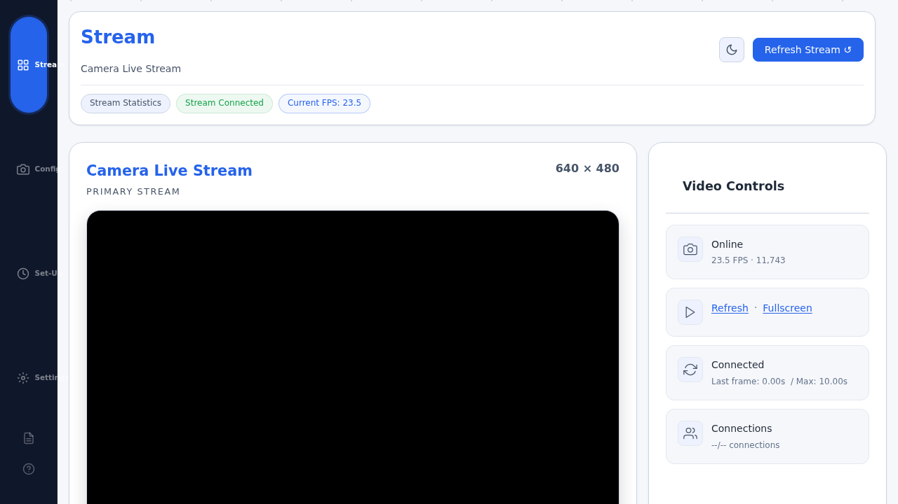

# motion-in-ocean 🌊📷

**Raspberry Pi CSI Camera Streaming in Docker (Picamera2 / libcamera)**

**Project status:** Early development. See [SECURITY.md](SECURITY.md) for supported security updates and vulnerability reporting.

[](https://github.com/CyanAutomation/motioninocean/actions/workflows/ci.yml)
[](https://github.com/CyanAutomation/motioninocean/actions/workflows/security-scan.yml)
[](https://github.com/CyanAutomation/motioninocean/actions/workflows/docker-publish.yml)

[](https://github.com/CyanAutomation/motioninocean/pkgs/container/motioninocean)
[](https://hub.docker.com/r/cyanautomation/motioninocean)
[](https://github.com/CyanAutomation/motioninocean/releases/latest)
[](LICENSE)

## About

Motion In Ocean turns a Raspberry Pi CSI camera into a reliable, containerised MJPEG stream with a REST control plane. It runs in two modes:

- **Webcam mode** – captures frames via Picamera2/libcamera and streams them over HTTP (port 8000), with a REST API for settings and actions.
- **Management mode** – a hub (port 8001) that discovers and aggregates multiple webcam nodes, providing a single dashboard for multi-camera deployments.

Common integrations: [Home Assistant](https://www.home-assistant.io/), [OctoPrint](https://octoprint.org/), and any MJPEG-capable viewer.



## Requirements

| Requirement    | Minimum                                             |
| -------------- | --------------------------------------------------- |
| Raspberry Pi   | Pi 3B+ or newer (Pi 4 / Pi 5 recommended)           |
| OS             | Raspberry Pi OS Bookworm (64-bit)                   |
| Docker         | 24.0+                                               |
| Docker Compose | v2.20+                                              |
| Architecture   | `linux/arm64` (Pi) or `linux/amd64` (dev / testing) |

> Images for `linux/arm64` and `linux/amd64` are published. The deployment Compose files default to ARM64 for Raspberry Pi. On an AMD64 host, set `MIO_COMPOSE_PLATFORM=linux/amd64` when starting the stack. The mock overlay enables synthetic camera frames and removes camera device access.
>
> `MIO_COMPOSE_PLATFORM` is a Compose-time image selection variable, not an application setting.

## Quick Start

### Before exposing the service to your network

The example `.env` files bind to `0.0.0.0` (all host interfaces). They leave authentication tokens empty, which disables token protection on the routes that support it; webcam Compose also defaults CORS to `*`. Anyone who can reach the published port may be able to use the web UI and unprotected endpoints.

For a local-only trial, edit `.env` and set `MIO_BIND_HOST=127.0.0.1` before starting Compose. For network access, configure a strong `MIO_WEBCAM_CONTROL_PLANE_AUTH_TOKEN` for webcam control-plane routes and/or `MIO_MANAGEMENT_AUTH_TOKEN` for protected management routes, and set `MIO_CORS_ORIGINS` to the origins you need. Discovery uses a separate shared secret. See [Authentication Boundaries and Headers](docs/guides/DEPLOYMENT.md#authentication-boundaries-and-headers) for route coverage and token flows. Authentication is optional, so configuring a token does not make every endpoint private.

**Webcam mode (single camera):**

```bash
cp -r containers/motion-in-ocean-webcam ~/containers/motion-in-ocean-webcam
cd ~/containers/motion-in-ocean-webcam
cp .env.example .env
docker compose up -d
```

Open `http://localhost:8000`.

**Management mode (multi-camera hub):**

```bash
cp -r containers/motion-in-ocean-management ~/containers/motion-in-ocean-management
cd ~/containers/motion-in-ocean-management
cp .env.example .env
docker compose up -d
```

Open `http://localhost:8001`.

To connect webcam nodes to the hub, follow the [directory-based multi-host setup](docs/guides/DEPLOYMENT.md#multi-host-setup-directory-based).

### Try webcam mode without a Raspberry Pi

Run these commands from the copied webcam deployment directory. The mock overlay enables mock camera mode and removes hardware device access. On a Raspberry Pi or another ARM64 host, use the default platform; on an AMD64 host, select its native image:

```bash
cd ~/containers/motion-in-ocean-webcam

# Raspberry Pi or ARM64 host
docker compose -f docker-compose.yaml -f docker-compose.mock.yaml up -d

# AMD64 development host
MIO_COMPOSE_PLATFORM=linux/amd64 docker compose -f docker-compose.yaml -f docker-compose.mock.yaml up -d
```

### Verify the deployment and view the stream

Run these commands from the copied deployment directory. Webcam mode may report `not_ready` while the camera initializes; retry until it returns HTTP 200 with `"status":"ready"`. Management mode does not require a camera and should return ready immediately. If webcam token authentication is enabled, include the bearer header shown in the API example below when checking `/ready`.

```bash
# Webcam deployment
docker compose ps
curl -i http://localhost:8000/ready

# If startup fails, inspect recent container logs
docker compose logs --tail=100 motion-in-ocean
```

For management mode, use `http://localhost:8001/ready` and the same `docker compose` commands from its deployment directory.

In webcam mode, open `http://localhost:8000/stream.mjpg` in a browser or MJPEG-capable client to view the camera stream. To inspect the webcam status API when a control-plane token is configured:

```bash
TOKEN='paste the MIO_WEBCAM_CONTROL_PLANE_AUTH_TOKEN value here'
curl -H "Authorization: Bearer ${TOKEN}" http://localhost:8000/api/status
```

The status response includes the current application status and stream availability. If no webcam token is configured, the `Authorization` header can be omitted. See [API Documentation](#api-documentation) for the full endpoint reference.

## Docker Images

Images are published to two registries on every release:

| Registry                         | Image                                  |
| -------------------------------- | -------------------------------------- |
| GitHub Container Registry (GHCR) | `ghcr.io/cyanautomation/motioninocean` |
| Docker Hub                       | `cyanautomation/motioninocean`         |

```bash
# Docker Hub (no authentication required)
docker pull cyanautomation/motioninocean:latest

# GitHub Container Registry
docker pull ghcr.io/cyanautomation/motioninocean:latest
```

Both registries publish the same multi-arch image (`linux/arm64`, `linux/amd64`) with identical tags (`latest`, `vX.Y.Z`, `X.Y.Z`, `X.Y`).

Motion In Ocean is locked to **Debian Bookworm**. No suite overrides are supported.

### Build Image

```bash
docker build -t motion-in-ocean:local .
```

### Build for Raspberry Pi (ARM64)

**Important:** Local `docker build` defaults to your host's CPU architecture:

- On ARM64 hosts (Linux ARM, Raspberry Pi itself) → builds ARM64 ✅
- On x86_64 hosts (Intel/AMD Mac, Linux x86) → builds x86, **won't work on Raspberry Pi** ❌

Raspberry Pi-specific camera packages (libcamera, picamera2) are ARM-only. If building on non-ARM hardware for Raspberry Pi deployment, explicitly target ARM64:

**Using Makefile (recommended):**

```bash
make docker-build-arm64       # ARM64 image (mock support included)
make docker-build-prod-arm64  # Production-tagged ARM64 image (same build profile)
```

**Using docker buildx directly:**

```bash
docker buildx build --platform linux/arm64 \
  -t motion-in-ocean:local .
```

**Note:** Multi-arch images (used in releases) are published with both `linux/arm64` and `linux/amd64` via CI automation; local builds default to your host architecture.

## API Documentation

Both webcam and management modes expose a built-in API reference at runtime:

| Endpoint            | Description                                      |
| ------------------- | ------------------------------------------------ |
| `GET /api/docs`     | Built-in API reference (browser, no auth required) |
| `GET /openapi.json` | OpenAPI 3.0 spec as JSON (for client generation) |
| `GET /version`      | Stable app version metadata (JSON)               |
| `GET /api/version`  | Alias of `/version`                              |

Open `http://localhost:8000/api/docs` (webcam) or `http://localhost:8001/api/docs` (management) after starting the container.

The spec lives at [docs/openapi.json](docs/openapi.json) and is served directly from disk at runtime.

## Full Documentation

- Documentation hub: [docs/README.md](docs/README.md)
- Canonical deployment guide: [docs/guides/DEPLOYMENT.md](docs/guides/DEPLOYMENT.md)
- Migration deltas only: [docs/guides/MIGRATION.md](docs/guides/MIGRATION.md)
- Feature flags reference: [docs/guides/FEATURE_FLAGS.md](docs/guides/FEATURE_FLAGS.md)
- Container directory pattern specifics: [containers/README.md](containers/README.md)
- Runtime environment variable reference: [docs/ENVIRONMENT_VARIABLES_DOCUMENTATION_COMPLETE.md](docs/ENVIRONMENT_VARIABLES_DOCUMENTATION_COMPLETE.md)
- OpenAPI specification: [docs/openapi.json](docs/openapi.json)

## Environment Variables

Use canonical `MIO_*` application variables such as `MIO_APP_MODE`, `MIO_PORT`, and `MIO_BIND_HOST`. Older names such as `APP_MODE`, `RESOLUTION`, `MANAGEMENT_AUTH_TOKEN`, and `DISCOVERY_TOKEN` are not read by the current runtime. The deprecated compatibility settings `MIO_PI3_PROFILE` and `MOTION_IN_OCEAN_ALLOW_PRIVATE_IPS` are still supported; prefer `MIO_PERFORMANCE_PROFILE` and `MIO_ALLOW_PRIVATE_IPS` respectively.

See the [runtime environment variable reference](docs/ENVIRONMENT_VARIABLES_DOCUMENTATION_COMPLETE.md) for supported variables and the [deployment guide](docs/guides/DEPLOYMENT.md) for migration details.

## Contributing

Contributions are welcome! Please read [CONTRIBUTING.md](CONTRIBUTING.md) before submitting a pull request, and review the [Code of Conduct](CODE_OF_CONDUCT.md).

Run `make ci` for the local lint, formatting, Python type-check, feature-flag, and test checks. Run `npm run type-check` for frontend TypeScript checks. GitHub Actions also runs workflow linting and a runtime dependency-resolution matrix.
